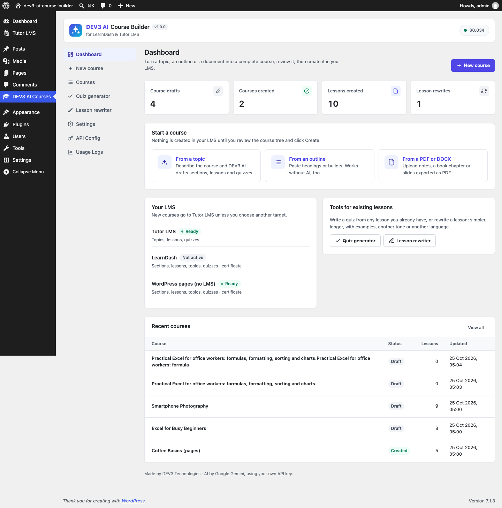

# DEV3 AI Course Builder for LearnDash & Tutor LMS

Turn a topic, an outline or a PDF/DOCX into a complete course: sections, lessons, quizzes and certificate text. Review everything, then create it in Tutor LMS, LearnDash or as WordPress pages.



## Features

DEV3 AI Course Builder is an add-on for Tutor LMS and LearnDash (and works without any LMS).

* **Sources**: a topic, a pasted outline (Markdown headings, numbered or bulleted lists) or an uploaded PDF, DOCX, TXT or Markdown file.
* **Course tree editor**: sections, lessons, topics and quizzes; add, rename, reorder, delete; lesson content with live preview; question editor for 8 question types.
* **Review first**: nothing is created in your LMS until you click Create course. Every DEV3 AI result is a draft you accept, edit or reject.
* **Background creation** with progress, retry and **undo build**.
* **Tutor LMS**: courses, topics, lessons and quizzes with questions saved in Tutor's own tables.
* **LearnDash**: courses, lessons, topics, quizzes (ProQuiz questions), course builder steps, section headings and a certificate.
* **No LMS**: a parent course page with child lesson pages, self-check quiz pages and a certificate page.
* **Quiz generator** for lessons you already have, and a **lesson rewriter** (simplify, expand, examples, shorten, clarity, tone, reading level, translate) with undo.
* **Course Certificate** block and `[dev3lm_certificate course="ID"]` shortcode: printable certificate for learners who completed the course.
* Works with DEV3 AI switched off: outline import, template outlines, manual editing, basic (heuristic) quiz questions and description/certificate templates.

A Google AI API key is needed for the DEV3 AI features. You pay Google for usage; Google offers a free tier. A monthly budget cap is built in.

## Requirements

- WordPress 6.0 or newer (tested up to 6.8)
- PHP 7.4 or newer
- Optional: your own Google AI API key (from Google AI Studio) to switch on the DEV3 AI features. The rest of the plugin works without one.

## Installation

### From the release zip

1. Download `dev3-ai-course-builder.zip` from the [latest release](https://github.com/dev3tech/dev3-ai-course-builder/releases/latest).
2. In WordPress, go to **Plugins → Add New → Upload Plugin**, choose the zip and click **Install Now**.
3. Click **Activate**.

### Build from source

```bash
git clone https://github.com/dev3tech/dev3-ai-course-builder.git
cd dev3-ai-course-builder
composer install --no-dev
npm ci
npm run build
```

Then copy the `dev3-ai-course-builder` folder into `wp-content/plugins/` and activate it.

### Getting started

1. Upload the plugin zip in Plugins > Add New > Upload and activate it.
2. Optional: activate Tutor LMS or LearnDash.
3. Go to DEV3 AI Courses > API Config and paste your Google AI API key (or skip it to work without AI).
4. Click New course.

## FAQ

### Do I need LearnDash or Tutor LMS?
No. Without an LMS the course is created as WordPress pages.

### Is anything published automatically?
No. You review the course tree first, and created items use the status you choose (Draft by default).

### Can I undo a course creation?
Yes. Undo build moves everything the build created to the trash (or deletes it permanently).

### Which data is sent to Google?
Only the topic/outline/document text (capped in Settings) and the lesson text you ask DEV3 AI to work on.

## Documentation

The full HTML guide (installation, settings, hooks and FAQ) is in [`docs/index.html`](docs/index.html). Open it in a browser after cloning or downloading the repository.

## Changelog

### 1.0.0
* Initial release.

## Licence

Released under the GNU General Public License v2.0 or later (GPL-2.0-or-later). See [LICENSE](LICENSE).

## More from DEV3

- [DEV3 AI Course Builder for LearnDash & Tutor LMS on the DEV3 Marketplace](https://www.dev3.tech/item/dev3-ai-course-builder)
- [More WordPress plugins, themes and templates from DEV3](https://www.dev3.tech/marketplace)
